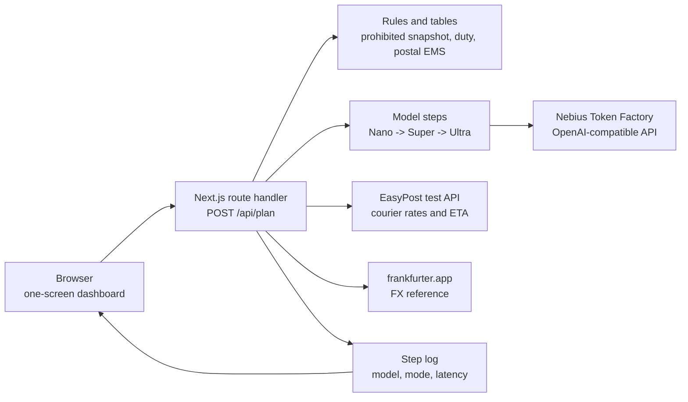

# Hakobu

**One screen for cross-border parcels: Korea ↔ Japan.**

Hakobu turns an item list into a reviewable shipment plan: prohibited/quarantine flags, HS code candidates, a duty and tax estimate, a formatted address, and a side-by-side carrier comparison with ETA. Every generative AI call goes to **Nebius Token Factory** and runs on **NVIDIA Nemotron** models. Every output is labeled as a hint, an estimate, a table value, a live API response, or a deterministic mock — and a human decides what to do with it.

> **Status:** Hackathon build for the Nebius x NVIDIA Global AI Hackathon, track **Best Apps & Agents**.  
> **Repository name:** `hakobu` · **Live demo:** [TBD] · **Demo video:** [TBD] · **Source URL:** [TBD]  
> **License:** MIT (see [License](#license)).

Hakobu does not take payment, buy postage, file customs documents, or track a parcel. It is a preparation and comparison layer, not a customs broker.

---

## The problem

A first-time sender between Japan and Korea answers the same four questions for every parcel:

1. Can I send this item at all?
2. Which HS code applies, and who is responsible for it?
3. What duty and tax will the receiver pay?
4. Which service is cheaper and faster, and how do I write the address?

The answers live in different places: Japan Post, Korea Post, Korea Customs, Japan Customs, quarantine pages, carrier rate calculators, and address references. Each source is good at one thing. None of them produces a single reviewable plan. The result is tab-hopping, a calculator, and a guess.

Hakobu is the one screen for that job. The first corridor is Korea ↔ Japan because it is the corridor I know personally; the demo uses **Japan → Korea**.

---

## What it does

### One flow

1. **Describe the parcel.** Enter one item per line as `description | value` in JPY, a weight between 0.1 and 30 kg, and a destination address. The route handler validates the request. Nemotron 3 Nano classifies each item into a category and a three-state risk level. There is no photo upload in this build.

2. **Check prohibited and quarantine risk.** A curated rule pack (`data/prohibited.json`) produces a three-state flag per item: **LOW**, **NEEDS CHECK**, or **HIGH**. Each flag includes a reason and an official source link. The app never auto-rejects an item and never declares one admissible.

3. **Get HS code candidates.** Nemotron 3 Super proposes candidate headings with plain-language descriptions, a rationale, and a confidence level. Nemotron 3 Ultra separately verifies the plan fields (prohibited flags, HS candidates, address) and returns **SUPPORTED**, **UNCERTAIN**, or **CONTRADICTED** with a reason and a human action. The sender remains responsible for the final code; the app calls them candidates, not conclusions.

4. **Estimate duty and tax.** The rules module (`lib/duty.ts`) computes an estimate from the destination, the declared value, the FX rate, and a duty rate derived from the first HS candidate. The card shows the assumptions, the threshold applied, the FX date, and an official source link. It is labeled **estimate**, not a quote and not legal advice.

5. **Format the address.** Nemotron 3 Nano converts the address into the destination format and supplies a romanized line. Original and converted addresses sit side by side. Recipient names and phone numbers are never collected. Formatting is a hint; deliverability is not validated.

6. **Compare rates and ETA.** Courier rates come from the EasyPost test API and carry a **LIVE** badge with a timestamp, or a **MOCK** badge when no key is configured. One EMS postal row comes from `data/jp_post_rates.json`: Japan Post for JP → KR and Korea Post for KR → JP, always labeled **TABLE** with an effective date and `verified: false`. FX comes from frankfurter.app and is labeled **LIVE** or **FALLBACK**. Prices are normalized to JPY and KRW and sorted by JPY equivalent. No rate is purchasable from Hakobu.

7. **Review the plan.** The `08 / Routing` model/step panel logs the model, mode, and latency for each of the four model calls. Verifier verdicts sit next to the fields they checked. The plan stays in the browser session; the app never submits it.

### Features

- **One-screen numbered flow** from parcel description to comparison: `01 / Parcel` through `08 / Routing`.
- **Three-state compliance flags** with reasons and official links. No auto-reject.
- **HS candidate list** with a separate verifier pass and a visible "the sender confirms the final code" statement.
- **Duty/tax estimate** with visible assumptions and thresholds, labeled as an estimate.
- **Address review** with the original and destination format side by side.
- **Provenance on every rate:** `LIVE`, `MOCK`, or `TABLE`, with timestamps and effective dates.
- **Model/step panel** showing model, mode, and latency per step.
- **Verifier checks** with a verdict, a reason, and a suggested human action.
- **Visible deterministic fallback.** Missing or failed integrations return labeled MOCK data. There is no separate recorded-run mode and no provider fallback beyond the labeled mock path.
- **No database.** No parcel history, no stored addresses, no accounts.
- **No budget or rate-limit controls in this build.** Limits: [TBD].

### What it deliberately does not do

- No payment and no label purchase.
- No customs filing or electronic declaration.
- No automatic rejection of an item.
- No claim that an HS candidate is final or binding.
- No "real-time" label on a table-based postal rate.
- No legal, tax, or customs advice.

These are scope decisions. The product is the preparation layer, and the human remains responsible.

---

## Demo scenario

The sample shipment is synthetic: a 1.2 kg parcel to a Seoul address containing a ceramic teacup (¥24,000) and an aerosol sunscreen (¥3,800).

- The aerosol is flagged **NEEDS CHECK** for a pressurized-container/carrier restriction, with an official source link. The app does not remove it automatically; the sender can edit the item list and build again.
- The teacup gets HS candidates from Super and a separate verifier pass from Ultra.
- Duty is estimated from the rules module, with the assumptions and threshold visible.
- The destination address is formatted for Korea and shown beside the original.
- EasyPost test rates (LIVE or MOCK) and the EMS table row (TABLE) appear in one list with different badges.
- The model/step panel shows the four calls with model, mode, and latency.

Clicking **Load sample shipment** only fills the form. Click **Build plan** to run the pipeline.

Screenshot: [TBD]

All names, addresses, and parcel contents in the demo are synthetic. Do not record a real address or a real phone number.

---

## Architecture



### Request flow

```text
Browser
  -> POST /api/plan
       1. Nano: classify items and match the prohibited rule pack
       2. Rules: prohibited/quarantine flags with source links
       3. Super: HS candidates
       4. Nano: address formatting
       5. Ultra: verify prohibited flags, HS candidates, and address
       6. Rules + FX: duty/tax estimate
       7. EasyPost + postal table + FX: rate comparison and ETA
       8. Response: plan, provenance, verifier verdicts, step log
  -> UI: review the plan; nothing is submitted or stored
```

### Components

| Path | Responsibility |
|---|---|
| `app/app/Dashboard.tsx` | Client form, numbered result cards, verifier checks, rate table, model/step panel |
| `app/app/api/plan/route.ts` | Validates the request and orchestrates the four model steps, rules, duty, rates, and response |
| `app/app/page.tsx` | Server page; reads the integration booleans for the LIVE/MOCK pills |
| `app/app/layout.tsx` | Root layout and metadata |
| `app/app/globals.css` | Plain CSS for the entire UI |
| `app/lib/llm.ts` | Nebius Token Factory client, model selection, timeout, and deterministic mock fallback |
| `app/lib/rates.ts` | EasyPost test adapter plus the postal EMS table |
| `app/lib/duty.ts` | Rules-based duty and tax estimate with thresholds and assumptions |
| `app/lib/fx.ts` | frankfurter.app adapter with 10-second timeout and fallback rates |
| `app/lib/types.ts` | Shared request/response types |
| `app/data/prohibited.json` | Curated prohibited/restricted snapshot with source URLs |
| `app/data/jp_post_rates.json` | Table-based Japan Post / Korea Post EMS samples |
| `app/scripts/smoke.mjs` | End-to-end smoke test against a production build |

### Repository layout

The runnable Next.js app lives in `app/` inside the `hakobu` repository:

```text
app/
├── app/
│   ├── Dashboard.tsx
│   ├── api/plan/route.ts
│   ├── globals.css
│   ├── layout.tsx
│   └── page.tsx
├── data/
│   ├── jp_post_rates.json
│   └── prohibited.json
├── lib/
│   ├── duty.ts
│   ├── fx.ts
│   ├── llm.ts
│   ├── rates.ts
│   └── types.ts
├── scripts/
│   └── smoke.mjs
├── .env.example
├── .gitignore
├── LICENSE
├── README.md
├── next-env.d.ts
├── next.config.mjs
├── package.json
├── package-lock.json
└── tsconfig.json
```

`node_modules/` and `.next/` are generated and gitignored. There is no `app/api/rates/route.ts`, no `lib/ai/` directory, and no database in this build.

### Design principles

- **Server owns the keys.** No model or carrier key reaches the browser.
- **Server recomputes money.** The client cannot submit a price and have it accepted.
- **Every number has a basis.** `live`, `mock`, `table`, `estimate`, `AI hint`, or `rule`.
- **Invalid model output is never trusted.** If a response is not valid JSON, the step falls back to its deterministic mock payload and is logged with a note.
- **Every irreversible action is human.** The app prepares; the sender confirms outside the app.

---

## NVIDIA model usage on Nebius Token Factory

All model calls use the OpenAI-compatible endpoint:

```text
base_url = https://api.tokenfactory.nebius.com/v1/
api_key  = process.env.NEBIUS_API_KEY
```

No other inference provider is on the critical path. If Token Factory is unavailable, the step returns deterministic mock content with a visible MOCK label instead of switching vendors.

| Role | NVIDIA model | Model ID | Why this tier | Context | Price (USD / 1M in / out) | Region |
|---|---|---|---|---|---|---|
| Classify items and format the address | Nemotron 3 Nano 30B-A3B | `nvidia/NVIDIA-Nemotron-3-Nano-30B-A3B` | Bounded, format-constrained tasks; low-cost tier | 262K | 0.06 / 0.24 | eu-north1 |
| HS code candidates | Nemotron 3 Super 120B-A12B | `nvidia/nemotron-3-super-120b-a12b` | More reasoning for taxonomy and rationale; cheaper than Ultra | 256K | 0.30 / 0.90 | us-central1 |
| Verifier / critic | Nemotron 3 Ultra 550B-A55B | `nvidia/Nemotron-3-Ultra-550b-a55b` | Largest model in the family; reasoning-heavy verification; checks Nano/Super outputs and flags uncertainty | 1,024K | 1.00 / 3.00 | us-central1 |

Context, price, and region are catalog metadata from the Nebius Token Factory public model catalog as of October 2026. They can change and are not read by the app at runtime. The app reads model IDs from `MODEL_NANO`, `MODEL_SUPER`, and `MODEL_ULTRA` overrides, and does not compute or display cost in this build.

No vision model and no fallback model are wired in this build. Photo input with Nemotron 3.5 Super VL remains a next step.

### Why route at all?

A single strong model on every step would be simpler to write and worse to operate. Classification and address formatting are bounded tasks: turn a sentence into a small JSON object, or reorder an address. Paying the largest model for that is waste. Verification is a reasoning task: compare a claim against evidence and decide whether the evidence supports it. That is where the strongest model earns its cost.

The step runner makes the trade-off visible:

- **Nano** classifies items and formats the address.
- **Super** proposes HS candidates.
- **Ultra** verifies the plan fields and never generates the primary answer.

### The verification contract

Ultra receives the item list, the Nano/Super outputs, the prohibited rule sources, and the output schema. It returns one verdict per checked field:

```json
{
  "field": "hs_candidates",
  "verdict": "uncertain",
  "reason": "The item description does not identify the ceramic body or glaze; two headings remain plausible.",
  "humanAction": "Confirm the material and intended use with the sender."
}
```

Verdict values: `supported`, `uncertain`, `contradicted`.

Rules enforced in the prompt and in the UI:

1. **No new facts.** The verifier may not introduce a code, rate, or rule that is not in the supplied evidence. If evidence is insufficient, it returns `uncertain`.
2. **No silent overwrite.** The generator outputs and the verifier checks are separate fields in the response. A contradiction stays visible instead of replacing the candidate.
3. **Visible fallback.** If Ultra times out or returns invalid JSON, the verifier step returns its deterministic mock checks and is logged with `mode: "mock"`. A degraded check is never presented as a full live check.

The app does not confirm or submit anything. The final HS code, address, and shipping decision remain with the sender.

### Where Nebius Token Factory helped

- **One OpenAI-compatible endpoint.** The integration is a base URL and an API key. The client is ordinary OpenAI-style code, with no provider-specific SDK.
- **One key for three model sizes.** Nano, Super, and Ultra can be routed without three accounts or three billing relationships.
- **A wide capability range.** The same API covers cheap classification, mid-tier HS reasoning, and a verifier with a 1M-token context, so the pipeline does not need a second provider.
- **Long context for verification.** Ultra can see the whole shipment plan plus the rule sources in one call for demo-sized inputs. Long-context quality on this task: [TBD - measure].
- **OpenAI-compatible usage fields.** Prompt and completion token counts come back in the response. This build does not surface them in the UI.

### Other Nebius services

**Nebius AI Cloud** is not on the critical path for this demo. Hakobu is a stateless Next.js app, and Token Factory covers inference. The natural next use is a **Nebius Serverless Job** that runs nightly: fetch official rate and rule pages, diff them against the versioned JSON, and open a review item. That job would make the rule packs fresher without putting a scheduler in the web app. Status: [TBD - fill after build].

**Token Factory Sandboxes** are not used. They are a better fit for a coding or verification agent that needs isolated execution; Hakobu does not execute user code.

No other Nebius service is required to run the demo. I am listing AI Cloud because it is the honest next step in the architecture, not because I want to imply it is already in use.

---

## Data sources and provenance

| Output | Source | Basis label | Refresh | What the user sees |
|---|---|---|---|---|
| Prohibited / quarantine flag | Curated rule pack + official links | `rule` / `AI FLAG` | Per request, from a static snapshot | Flag, reason, source link |
| HS candidates | Nemotron 3 Super + Nemotron 3 Ultra | `AI HINT` | Per request | Codes, rationale, confidence, verifier checks |
| Duty / tax | Rules module + FX | `ESTIMATE` | Per request | Amount, assumptions, threshold, official link |
| Address | Nemotron 3 Nano | `AI FORMATTED` | Per request | Original vs formatted, romanized line |
| Courier rate / ETA | EasyPost test API | `LIVE` / `MOCK` | Per request, no cache | Price, ETA, timestamp, "test rate" |
| Postal rate / ETA | Japan Post / Korea Post EMS table | `TABLE` | Manual, versioned | Price, ETA, effective date, `verified: false` |
| FX | frankfurter.app | `LIVE` / `FALLBACK` | Per request, no cache | Rate and date |

Official source URLs are stored in `data/*.json` next to `effectiveFrom` and a human-readable note. The postal table is explicitly marked `"verified": false`; the values are samples and must be checked against the official Japan Post or Korea Post page before use.

### The live/table distinction

The UI does not have a generic "real-time" badge. It renders the `basis` field and the relevant date:

```ts
type RateQuote = {
  id: string;
  carrier: string;
  service: string;
  priceJpy: number;
  priceKrw: number;
  priceOriginal: number;
  currency: string;
  etaDays: { min: number; max: number } | null;
  basis: "live" | "mock" | "table";
  source: string;
  sourceUrl: string;
  fetchedAt: string;
  effectiveFrom?: string;
  verified?: boolean;
  note?: string;
};
```

- **EasyPost test rates** are live API responses, but they are test-mode rates, not purchasable quotes. The UI says so.
- **Mock rates** are deterministic demo values produced when `EASYPOST_API_KEY` is absent or the request fails. The UI labels them MOCK.
- **Postal rates** are an official table with an effective date, not a live API. The UI says so.
- **FX** is a reference rate from frankfurter.app (ECB-based), not a transaction rate. When the request fails, the UI labels the sample rates FALLBACK.
- **Duty** is a rules-based estimate with visible assumptions, not a customs assessment.

### Cost model

This build does not compute or display per-step or per-shipment cost. The step panel shows model, mode, and latency only. Cost per shipment: [TBD - measure].

### Caching and recomputation

- No server-side cache is implemented. Every upstream request uses `cache: "no-store"`.
- The plan is recomputed on every **Build plan** submission; the client never supplies a price.
- LLM responses are not cached.

---

## Privacy and security

- **Server-only keys.** `NEBIUS_API_KEY` and `EASYPOST_API_KEY` are read only in server code. `.env*` files are gitignored; `.env.example` contains names only.
- **Address minimization.** Recipient names and phone numbers are never collected. Only the destination address lines are sent to the model for formatting.
- **No persistence.** No database, no parcel history, no stored addresses. The plan is returned to the browser and held in React state for the session.
- **No client trust.** Rates and duty are recomputed server-side.
- **Prompt injection defense.** Item descriptions and addresses are treated as untrusted evidence, not instructions. The system prompts separate evidence from instructions.
- **Budget controls.** No per-IP rate limit or daily model-spend cap is implemented in this build. Limits: [TBD].

### What is sent to the model

| Data | Sent to Token Factory? | Notes |
|---|---|---|
| Item description | Yes | Needed for classification and HS candidates |
| Declared value in JPY | Yes | Needed for classification and duty context |
| Weight and direction | Yes | Needed for HS context |
| Address lines | Yes, only for the address step | Names and phone numbers are not collected |
| Recipient name | No | Not collected by the form |
| Phone number | No | Not collected by the form |
| API keys | No | Server-side only, never in prompts or logs |
| Payment data | Not collected | Hakobu does not take payment |

---

## Setup

### Prerequisites

- Node.js 20 (built with v20.19.2)
- npm 11.21.0 (the committed `package-lock.json` is the source of truth)
- Optional: a Nebius Token Factory account and API key for live model calls
- Optional: an EasyPost account with a **test** API key for live courier rates

No database, GPU, or Docker setup is required. The app runs without keys in labeled MOCK mode.

### 1. Clone the repository

```bash
git clone [TBD] hakobu
cd hakobu/app
npm install
```

### 2. Configure environment variables

```bash
cp .env.example .env.local
```

Edit `.env.local`:

```bash
# Nebius Token Factory (OpenAI-compatible)
# Leave empty to use deterministic MOCK responses, clearly flagged in the UI.
NEBIUS_API_KEY=
NEBIUS_BASE_URL=https://api.tokenfactory.nebius.com/v1

# Model routing. Override only if the Token Factory catalog changes.
MODEL_NANO=nvidia/NVIDIA-Nemotron-3-Nano-30B-A3B
MODEL_SUPER=nvidia/nemotron-3-super-120b-a12b
MODEL_ULTRA=nvidia/Nemotron-3-Ultra-550b-a55b

# EasyPost test mode. Leave empty for deterministic MOCK carrier rates.
EASYPOST_API_KEY=
```

Rules:

- Never commit `.env.local` or any key. `.env*` is gitignored; `.env.example` contains names only.
- Use an EasyPost **test** key. Do not use a production key for the demo.
- If `NEBIUS_API_KEY` is missing, every model step returns deterministic mock content with `mode: "mock"` and a visible MOCK label. The app does not fall back to another model provider.
- If `EASYPOST_API_KEY` is missing, courier rows are deterministic mock rates labeled MOCK. The postal TABLE row is still shown.
- If `frankfurter.app` cannot be reached, the FX row is labeled FALLBACK and uses sample rates.
- There is no `TAVILY_API_KEY`, `DEMO_MODE`, `BUDGET_CAP_USD`, or `RATE_LIMIT_PER_MIN` in this build.

### 3. Run

```bash
npm run dev
```

Open [http://localhost:3000](http://localhost:3000).

Production build:

```bash
npm run build
npm start
```

Checks:

```bash
npm run build
npm test
```

`npm test` runs `node scripts/smoke.mjs`. The smoke test requires a production build, starts `next start` on port 3999, posts the synthetic sample to `/api/plan`, asserts at least four model steps and one rate, checks that a TABLE row is present and rates are sorted by JPY, checks that missing keys produce MOCK labels, checks `GET /`, and stops the server. It exits nonzero on failure. There are no `lint` or `typecheck` scripts in `package.json`.

### 4. Load the sample shipment

Click **Load sample shipment**, then click **Build plan**. The sample is synthetic: a 1.2 kg parcel to a Seoul address with a ceramic teacup and an aerosol sunscreen. It is designed to show a NEEDS CHECK flag, HS candidates with a verifier pass, a duty estimate, an address comparison, and a LIVE/MOCK/TABLE rate list.

---

## Judge testing notes

- **Demo URL:** [TBD]
- **Login:** No login is implemented. Public URL: [TBD].
- **Video:** [TBD]
- **Track:** Best Apps & Agents
- **Cost to test:** [TBD] — depends on the hosting provider.
- **Rate limit:** Not implemented in this build. [TBD] if added.
- **Daily budget cap:** Not implemented in this build. [TBD] if added.

### A three-minute test path

1. Open the demo and click **Load sample shipment**, then **Build plan**.
2. Read the numbered sections: `01 / Parcel` → `02 / Compliance` → `03 / Classify` → `04 / Verify` → `05 / Estimate` → `06 / Format` → `07 / Compare` → `08 / Routing`.
3. Open the `08 / Routing` model/step panel. Confirm that Nano classifies, Super proposes HS candidates, Nano formats the address, and Ultra verifies. Note the model, mode, and latency per step.
4. Read the `04 / Verify` checks. Each check shows a verdict, a reason, and a **Human action** line. The app should show `UNCERTAIN` where the evidence is thin.
5. Compare the `TABLE` EMS row with a `LIVE` EasyPost row (or a `MOCK` row when no key is configured). Note the different badges, timestamps, and effective dates.
6. Read the `05 / Estimate` card. It should show the assumptions, the threshold, and say **estimate**, not a quote.
7. Edit the item list and click **Build plan** again. The flags and the plan should update; nothing is submitted or paid.

### If something fails

- **Token Factory error:** the affected step returns deterministic mock content, is logged as `mode: "mock"`, and the UI shows a MOCK label. It does not switch providers.
- **EasyPost error:** courier rows become deterministic mock rates labeled MOCK; the postal TABLE row remains available.
- **FX error:** the FX row is labeled FALLBACK with sample rates.
- **No recorded-run mode:** there is no separate recorded-run mode in this build. The fallback is always the deterministic mock path with visible MOCK labels.
- **Out of budget / rate limited:** not applicable in this build; no cap or rate limit is implemented. [TBD] if added.

### What not to expect

Hakobu does not issue a shipping label, take payment, file customs, or track a parcel. It does not provide legal or tax advice. The HS code is a candidate until the sender confirms it. The EasyPost rates are test-mode rates. The postal rate is a table, not a live API.

---

## Evaluation

There is no evaluation harness in this repository yet. The intended metrics are:

- classification field accuracy (category, risk level, risk signals),
- prohibited/quarantine flag recall, with `NEEDS CHECK` counted as a flag rather than a miss,
- HS top-3 recall against a human-labeled reference,
- address field accuracy after formatting,
- verifier calibration (does `uncertain` correlate with incomplete or wrong generator output?),
- p50/p95 latency per step,
- cost per shipment from actual token usage.

**Results:** [TBD - fill after build]. No metric is claimed in this README until it can be reproduced from a published harness and raw outputs.

The evaluation set size, the labeling rules, and the raw model outputs will be published with the repo. The goal is not a flattering number; it is a number a judge can rerun.

---

## Limitations and disclaimer

Hakobu is a hackathon prototype. It is not a customs broker, freight forwarder, or tax advisor.

- **Estimates, not advice.** Duty, tax, HS, prohibited/quarantine, and ETA outputs are estimates or hints. They are not legal, tax, or customs advice. The sender and importer are responsible for the final declaration. Official sources prevail.
- **HS candidates are not binding.** The app ranks candidates and shows its reasoning; it does not classify goods definitively. A wrong code can cause delays, fees, or seizure.
- **Prohibited/quarantine rules change.** The rule pack is a snapshot with source links. It may be incomplete or stale. Always check the official page and the carrier before shipping.
- **EasyPost test mode.** Rates and ETAs are test API responses, not purchasable quotes. They may not match a real account, negotiated rate, fuel surcharge, or remote-area fee.
- **Postal table.** Postal rates come from a sample EMS table, not a live API. The table has an effective date, is marked `verified: false`, and may lag a revision. It does not model every surcharge or option.
- **FX.** frankfurter.app provides a reference rate, not the rate a card or bank will use. The fallback rates are samples.
- **ETA.** Carrier estimates and postal ranges do not model customs delays, weather, or peak season.
- **LLM errors.** Models can misread an item, miss a risk signal, or produce a plausible wrong candidate. The verifier reduces this risk; it does not eliminate it. Human confirmation is required.
- **Address formatting.** The app formats an address; it does not guarantee deliverability. It does not validate against a postal authority database.
- **Single corridor.** Korea ↔ Japan is the only corridor implemented. The demo uses Japan → Korea.
- **No payment, label, filing, or tracking.** Out of scope by design.
- **Demo availability.** No rate limit or budget cap is implemented in this build. The demo may be unavailable depending on the hosting provider. There is no recorded-run mode; failures show labeled MOCK data.
- **Data.** Demo data is synthetic. Do not enter a real address or phone number into the public demo.

If any of these limitations is unacceptable for a real shipment, use the official source or a licensed professional. Hakobu is a preparation aid.

---

## License

MIT License

Copyright (c) 2026 Hakobu contributors

Permission is hereby granted, free of charge, to any person obtaining a copy
of this software and associated documentation files (the "Software"), to deal
in the Software without restriction, including without limitation the rights
to use, copy, modify, merge, publish, distribute, sublicense, and/or sell
copies of the Software, and to permit persons to whom the Software is
furnished to do so, subject to the following conditions:

The above copyright notice and this permission notice shall be included in all
copies or substantial portions of the Software.

THE SOFTWARE IS PROVIDED "AS IS", WITHOUT WARRANTY OF ANY KIND, EXPRESS OR
IMPLIED, INCLUDING BUT NOT LIMITED TO THE WARRANTIES OF MERCHANTABILITY,
FITNESS FOR A PARTICULAR PURPOSE AND NONINFRINGEMENT. IN NO EVENT SHALL THE
AUTHORS OR COPYRIGHT HOLDERS BE LIABLE FOR ANY CLAIM, DAMAGES OR OTHER
LIABILITY, WHETHER IN AN ACTION OF CONTRACT, TORT OR OTHERWISE, ARISING FROM,
OUT OF OR IN CONNECTION WITH THE SOFTWARE OR THE USE OR OTHER DEALINGS IN THE
SOFTWARE.

The repository includes a `LICENSE` file with this text so GitHub detects the
license in the About sidebar. A license mentioned only in the README does not
satisfy that check.

---

## Acknowledgements

- **Nebius Token Factory** for the OpenAI-compatible inference API and the Nemotron model catalog.
- **NVIDIA** for the Nemotron 3 Nano, Super, and Ultra models.
- **EasyPost** for test-mode courier rates and ETA.
- **frankfurter.app** for ECB-based FX reference rates.
- **Japan Post**, **Korea Post**, **Korea Customs Service**, and **Japan Customs** for the official rate tables and rule sources that the data packs are based on.

Model names and trademarks belong to their respective owners. Mention of a carrier or agency does not imply endorsement.
